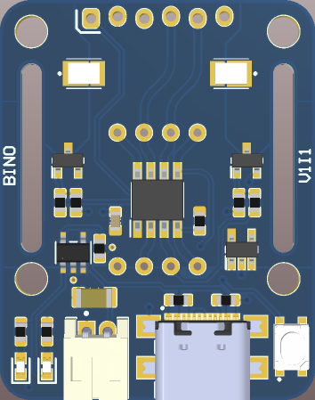
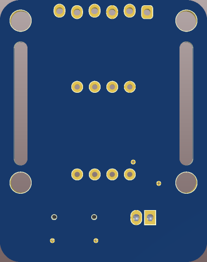

# Badge - HW #

Design done based on the PIC12F1840

## PCB ##

## KiCad ##

The KiCad project is in `kicad/`. Open `kicad/BADGE.kicad_pro` to use the
native-imported schematic hierarchy and PCB. Project-local symbols are in
`kicad/BADGE.kicad_sym`, and imported footprints are in
`kicad/BADGE-import-fps.pretty/`; the corresponding library tables are kept
alongside the project so it is self-contained.

Generated fabrication and review artifacts are under `kicad/outputs/`.